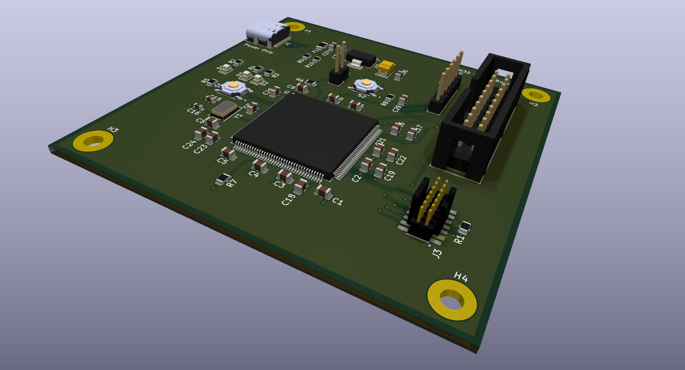

# STM32 Debug Board

A custom STM32F446ZE development board (hardware revision V1.0) designed for embedded software development, hardware debugging and testing.

## Description

The intent behind this project was to generate a board with three commonly used STM32 programming/debugging interfaces and verify that all work correctly. I used an STM32F446ZE because I want to use this part on a separate project, so wanted to create a test board that verifies all debug interfaces work as expected, then select the ones I want to use for that and future boards.

Designed using KiCad 10.0.3.

## Features

- STM32F446ZE microcontroller
- ARM 20-pin JTAG/SWD interface
- STDC14 debugging interface
- Additional SWD connector
- USB-C power input (no data)
- Two user LEDs
- One user push button
- Reset/boot controls

## Board Preview

Export of KiCad 3D Viewer:

## Version History

Version | Date        | Author    | Description
 ------ | ----        | ------    | -----------
 0.1    | 30/10/2026  | E. Watson | Initial version for review.
 0.2    | 30/10/2026  | E. Watson | Minor updates after review including footprint fixes.
 1.0    | 31/10/2026  | E. Watson | Folder portability issues fixed. Version added to PCB.
