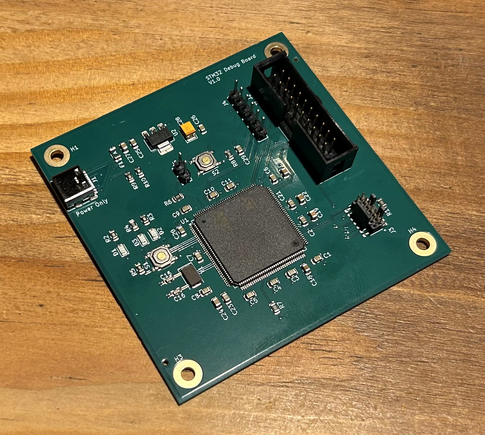
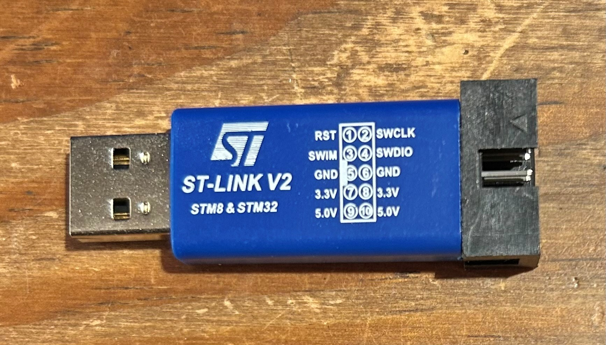
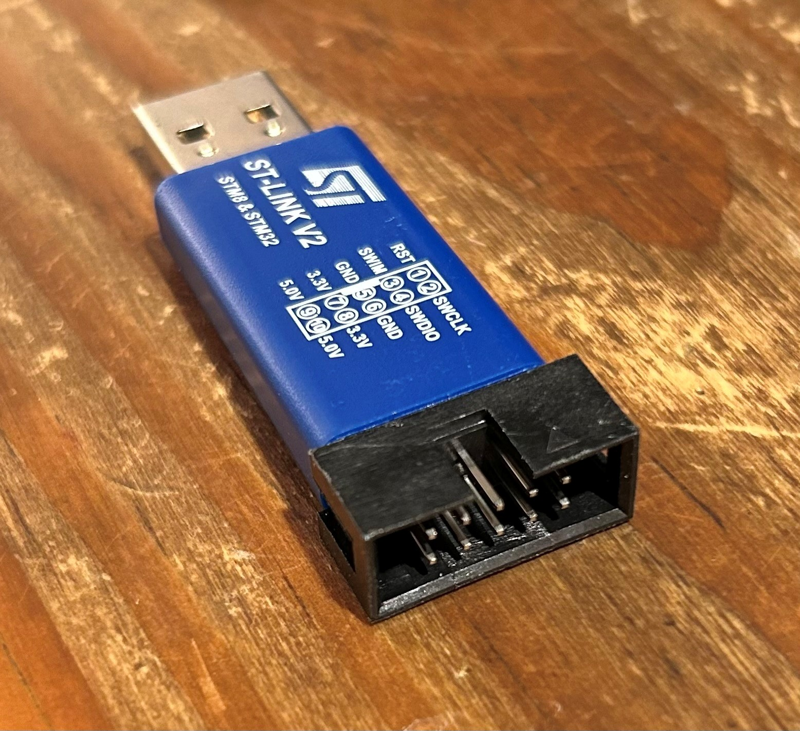

# STM32 Debug Board

A custom STM32F446ZE development board (hardware revision V1.0) designed for embedded software development, hardware debugging and testing.

**Hardware status:** V1.0 successfully manufactured and functionally validated, including standalone operation at 180 MHz. No corrective PCB rework was required during the planned bench tests.

## Description

The intent behind this project was to generate a board with three commonly used STM32 programming/debugging interfaces and verify that all work correctly. I used an STM32F446ZE because I want to use this part on a separate project, so wanted to create a test board that verifies all debug interfaces work as expected, then select the ones I want to use for that and future boards.

The project includes the KiCad hardware design, manufacturing files, STM32CubeMX/STM32CubeIDE example firmware and a hardware and firmware validation report.

Designed using KiCad 10.0.3.

## Board Preview


### KiCad 3D Render - V1.0


### Manufactured PCB - V1.0



## Hardware Features

- STM32F446ZET6 microcontroller: ARM Cortex-M4 with FPU, 512 KB flash, 128 KB SRAM, up to 180 MHz.
- ARM 20-pin JTAG/SWD debug interface (J2).
- STDC14 debug interface with virtual COM port support (J3).
- Additional six-pin SWD/SWO connector (J4).
- USB-C 5 V power input (power only; no USB data), 500 mA fuse and 3.3 V linear regulator.
- 8 MHz external crystal oscillator.
- Power indicator and two active-low user LEDs.
- User pushbutton, hardware reset button and BOOT0 jumper.
- Two-layer, 75 × 75 mm PCB with ENIG finish.

## Debug Interfaces

| Connector | Interface | SWD | JTAG | SWO | UART / VCP |
| --- | --- | :---: | :---: | :---: | :---: |
| J2 | ARM 20-pin, 2.54 mm | Yes | Yes | Yes | — |
| J3 | STDC14, 1.27 mm | Yes | Yes | Yes | Yes |
| J4 | Six-pin, 2.54 mm | Yes | — | Yes | — |

All three SWD interfaces, both JTAG interfaces and all three SWO interfaces have been functionally tested. J3 also provides bidirectional USART3 communication through the STLINK-V3MINIE virtual COM port.

### Tested Debuggers

| Debugger | Target connector | Test results |
| --- | --- | --- |
| ST-LINK/V2-ISOL | J2 | SWD, JTAG, SWO and debugger reset passed |
| STLINK-V3MINIE | J3 | SWD, JTAG, SWO, debugger reset and VCP passed |
| ST-LINK/V2-ISOL | J4 | SWD, SWO and debugger reset passed |
| Third-party ST-LINK/V2-style probe | J4 | SWD programming and breakpoint debugging passed in STM32CubeIDE; STM32CubeProgrammer connection unsuccessful |

The genuine ST probes were used with their corresponding ribbon cables on J2 and J3. J4 was tested using individual wires. Tests were conducted during incremental firmware development; not every probe and system-clock combination was retested at 180 MHz.

### J4 — Six-pin SWD Connector

**Connection precautions:** Disconnect target and probe power before changing connections. Power the target from its own USB-C input. Verify connector orientation, pin 1 and the probe pinout before connecting. J4 pin 1 is the target's 3.3 V reference, not an input for a probe's power supply. Do not connect ST-LINK/V2 pin 19 or third-party probe power outputs to the powered target.

The following wiring was successfully tested with the ST-LINK/V2-ISOL:

| J4 pin | Target signal | ST-LINK/V2-ISOL pin |
| ---: | --- | ---: |
| 1 | 3.3 V reference / VAPP | 1 |
| 2 | GND | **20** |
| 3 | SWDIO | 7 |
| 4 | SWCLK | 9 |
| 5 | NRST | 15 |
| 6 | SWO | 13 |

**Important:** The isolated ST-LINK/V2 has a different pinout from the standard ST-LINK/V2. Pin 4 is not ground on the isolated model. Use pin 20 for ground in the wiring above. See ST's [UM1075 user manual](https://www.st.com/resource/en/user_manual/dm00026748.pdf), Tables 4 and 5, and the validation report for details.

### Third-party ST-LINK/V2-style Debugger

The following low-cost 10-pin debugger (purchased from Amazon) was also tested successfully with STM32CubeIDE over SWD.

 

With the target powered separately, only three wires were connected:

| Debugger pin (tested unit only) | J4 pin | Signal |
| ---: | ---: | --- |
| 2 | 4 | SWCLK |
| 4 | 3 | SWDIO |
| 6 | 2 | GND |

No power or reset wires were connected. SWO and debugger-controlled reset were not tested with this probe. Other visually similar probes may have different pinouts or firmware; verify the markings and documentation for your specific unit. Genuine ST probes are recommended for reproducibility.

## Example Firmware

The [STM32 Debug Board test application](software/stm32_debug_board_test/) is an STM32CubeMX-generated STM32CubeIDE project using STM32CubeF4 V1.28.3 and the HAL drivers. The final configuration uses the external 8 MHz crystal and PLL to run the MCU at 180 MHz.

The application demonstrates:

- Alternating user LEDs every 500 ms.
- USART3 startup message and a one-second heartbeat.
- UART character echo at 115200 baud, 8 data bits, no parity, one stop bit, no flow control.
- User pushbutton press and release messages with 20 ms debounce.
- SWO/ITM diagnostic messages once per second, using stimulus port 0.
- Hardware reset and standalone startup without a connected debugger.

### Clock Configuration

| Clock | Final frequency |
| --- | ---: |
| HSE crystal | 8 MHz |
| SYSCLK / HCLK | 180 MHz |
| APB1 peripheral clock | 45 MHz |
| APB2 peripheral clock | 90 MHz |
| PLLQ output | 45 MHz (unused for USB/SDIO) |

The main PLL uses M=4, N=180, P=2, Q=8 and R=2, with voltage Scale 1, OverDrive and five flash wait states. The earlier 16 MHz HSI and direct 8 MHz HSE firmware configurations remain available in the Git history.

### Debug Configurations

Three reusable STM32CubeIDE launch configurations are included in the firmware project:

| Launch file | Purpose |
| --- | --- |
| `stm32_debug_board_test.launch` | SWD programming and debugging |
| `stm32_debug_board_test_JTAG.launch` | JTAG programming and debugging |
| `stm32_debug_board_test_SWV.launch` | SWD with Serial Wire Viewer (SWV) trace |

The SWV configuration uses a 180 MHz core clock setting and a 1 MHz SWO clock limit. If the firmware clock is changed, update the SWV core clock setting accordingly.

## Getting Started

### Hardware and Firmware

1. With power disconnected, connect a suitable debugger to the appropriate target connector. The STLINK-V3MINIE on J3 is recommended for access to SWD, JTAG, SWO and UART/VCP.
2. Ensure the BOOT0 jumper is open for normal application startup. Power the target using a 5 V USB-C supply and connect the debugger to the host computer.
3. Open STM32CubeIDE and import the existing project from `software/stm32_debug_board_test/`.
4. Build the Debug configuration.
5. Select the appropriate launch configuration from **Run → Debug Configurations** and start debugging.
6. Resume execution from `main()`. The two user LEDs should alternate every 500 ms.

The [CubeMX configuration file](software/stm32_debug_board_test/stm32_debug_board_test.ioc) is included for further firmware development. Preserve the user-code sections if regenerating the code. No regeneration is necessary simply to build the supplied firmware.

### UART and SWO Diagnostics

For UART output, connect through J3 using the STLINK-V3MINIE and open its virtual COM port at 115200 baud (8N1, no flow control). The application reports its startup, sends a `Running...` heartbeat once per second, echoes individual characters and reports button events.

For SWO output, use the SWV launch configuration and open the **SWV ITM Data Console** in STM32CubeIDE. While halted at `main()`, enable ITM stimulus port 0 if necessary, start trace capture and resume execution. The console should display `SWO: Running...` once per second.

See the validation report for detailed test results and troubleshooting, including the CubeMX PLLQ divider workaround.

## Hardware and Firmware Validation

The V1.0 prototype successfully completed the planned functional bench tests on 12 November 2026.

| Test | Result |
| --- | --- |
| Power supply and 3.3 V rail (~3.29 V measured) | PASS |
| SWD on J2, J3 and J4 | PASS |
| JTAG on J2 and J3 | PASS |
| SWO on J2, J3 and J4 | PASS |
| Bidirectional UART via J3 | PASS |
| User LEDs, button and hardware reset | PASS |
| Internal 16 MHz HSI oscillator | PASS |
| External 8 MHz HSE crystal | PASS |
| 180 MHz PLL, OverDrive and clock register checks | PASS |
| Final application regression and repeated standalone cold starts | PASS |

Final standalone USB input current was approximately 60 mA at 180 MHz. No PCB design defects were identified during the planned tests and no corrective hardware rework was required.

These results represent functional prototype validation, not exhaustive peripheral testing or production qualification.

### Validation Report

The full report includes test evidence, debugger connection details, clock configurations, power measurements, limitations and lessons learned:

- [Hardware and Firmware Validation Report — Markdown](hardware/docs/validation-report/STM32_Debug_Board_V1.0_Validation_Report.md)
- [Hardware and Firmware Validation Report — PDF](hardware/docs/validation-report/STM32_Debug_Board_V1.0_Validation_Report.pdf)

## Repository Structure

```text
stm32-debug-board/
├── hardware/                    KiCad hardware project
│   ├── assets/                   Board images and debugger photographs
│   ├── docs/                     Schematic, BOM and validation documentation
│   │   ├── bom/
│   │   ├── pdf/
│   │   └── validation-report/
│   ├── libs/                     Project-specific KiCad libraries and 3D models
│   ├── datasheets/               Component documentation
│   └── manufacture/              PCB fabrication and assembly outputs
├── software/
│   └── stm32_debug_board_test/   STM32CubeMX / STM32CubeIDE project
└── README.md
```

## Hardware Documentation and Manufacturing

- [Schematic — PDF](hardware/docs/pdf/stm32_debug_board_v1_0.pdf)
- [Bill of materials — CSV](hardware/docs/bom/stm32_debug_board.csv)
- [KiCad hardware project](hardware/)
- [Manufacturing files](hardware/manufacture/)

V1.0 was manufactured by JLCPCB as a two-layer, 75 × 75 mm PCB with ENIG finish. Five boards were ordered: two with top-side SMD assembly and three bare PCBs. The through-hole components were fitted manually for testing.

The manufacturing directory contains the V1.0 fabrication and assembly outputs, including Gerbers, drill files, BOM and component placement files.

## Version History

| Version | Date | Author | Description |
| --- | --- | --- | --- |
| 0.1 | 30/10/2026 | E. Watson | Initial version for review. |
| 0.2 | 30/10/2026 | E. Watson | Minor updates after review including footprint fixes. |
| 1.0 | 31/10/2026 | E. Watson | Folder portability issues fixed. Version added to PCB. |

V1.0 hardware and firmware validation completed on 12/11/2026. The PCB revision remains unchanged following testing.

## Licence

Project licensing is pending final review before public release. Third-party software, libraries and documentation are subject to their respective licence terms.
